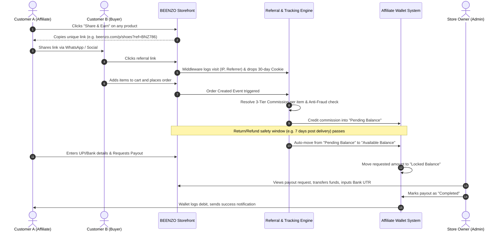

# BEENZO — Master Architecture & Specification: Universal Referral, Multi-Tier Commission & In-App Wallet Payout System

> **Platform:** Bagisto 2.4.x / Laravel 12 E-Commerce  
> **Brand:** BEENZO (`#c2955e` Warm Earth & Luxury Gold Palette)  
> **Module Path:** `packages/Webkul/Affiliate`  
> **Document Type:** Full Production Blueprint & Architectural Contract  
> **Target Audience:** Engineering, Product, UI/UX, Operations  

---

## 1. Vision & Core Philosophy

**BEENZO** ke referral program ka core objective hai **Zero-Friction Word-of-Mouth Sales**:
- Har registered customer bina kisi bureaucratic approval ya application ke direct affiliate/promoter hota hai.
- Customer store ke **kisi bhi product** ko 1-click me share kar sakta hai.
- Buyers ke purchase karne par customer ke **In-App Referral Wallet** me real money commission credit hota hai.
- Customer us wallet balance ko ya toh **apne Bank / UPI me withdraw** kar sakta hai, ya fir **BEENZO par checkout karte waqt shopping ke liye spend** kar sakta hai.
- Store owner (Admin) ke paas **3-Tier Granular Commission Control** hota hai (Product > Category > Global) taaki profit margins hamesha secure rahein.

---

## 2. End-to-End System Workflow



---

## 3. The 3-Tier Hierarchical Commission Engine

Different products have different profit margins. Isliye single flat rate lagane se low-margin products par loss ho sakta hai. Hamara engine **Item-by-Item Evaluation** karta hai:

### A. Precedence Order:
$$\text{Product Custom Rule} \succ \text{Category Rule} \succ \text{Global Default}$$

1. **Tier 1 — Product-Level Custom Override (Highest Priority):**
   - Specific product edit page par admin set kar sakta hai:
     - `Custom Percentage (%)` (e.g. 15% on high-margin luxury accessories).
     - `Custom Fixed Amount (₹)` (e.g. ₹500 on promotional launch items).
     - `Exclude from Referral Program` (0% commission flag for zero-margin products).
2. **Tier 2 — Category-Level Override (Medium Priority):**
   - Agar product ka individual rule nahi hai, system check karta hai product kis category me belong karta hai:
     - Example: *Watches & Jewelry* = 10%, *Footwear* = 7%, *Electronics* = 2%.
     - Multiple Categories Resolution: Agar product multiple categories me mapped hai, system **Highest Commission Rate** wali category choose karta hai (Admin setting me configurable: Highest vs Primary Category).
3. **Tier 3 — Global Store Default (Fallback):**
   - Agar product aur category dono par koi specific rule nahi mila, toh `Admin -> Configuration` me set kiya hua Global Default Rate apply hota hai (e.g. 5% ya flat ₹50).

### B. Mixed-Cart Calculation Matrix (Example):
Agar customer referred order me 3 different items khareedta hai:

| Cart Item | Qty | Price | Active Rule Applied | Calculation | Commission Earned |
|---|---|---|---|---|---|
| **Leather Jacket** | 1 | ₹4,000 | **Tier 1 (Product Rule):** 12% | $4000 \times 12\%$ | **₹480** |
| **Running Shoes** | 1 | ₹2,500 | **Tier 2 (Category Rule: Footwear):** 8% | $2500 \times 8\%$ | **₹200** |
| **Cotton Socks** | 2 | ₹300 | **Tier 3 (Global Default):** 5% | $(300 \times 2) \times 5\%$ | **₹30** |
| **Total Order** | | **₹7,100** | | | **₹710 Total** |

### C. Accounting & Base Calculation Rules:
- Commission is calculated on **`Item Price` $\times$ `Qty` minus Item-level Coupon Discounts**.
- **Shipping charges and GST/Taxes are strictly excluded** from commission calculation to protect store profit.
- Minimum Cart Subtotal threshold (optional setting: e.g. Commission only activates if order subtotal $\ge$ ₹499).
- Single-Order Commission Cap (optional safety lock: e.g. Max ₹2,500 commission per single order to safeguard against bulk B2B purchases).

---

## 4. In-App Wallet & Financial Ledger Architecture

Commission direct wallet balance me store hoti hai. Isme strict **Double-Entry Financial Accounting** use hogi taaki ek rupaye ka bhi mismatch na ho.

```
+------------------------------------------------------------------------+
|                     CUSTOMER REFERRAL WALLET                           |
+------------------------------------------------------------------------+
|  [ Available Balance: ₹2,450 ]   --> Ready for Withdrawal / Shopping   |
|  [ Pending Clearance: ₹710 ]     --> Waiting for Return Window to pass |
|  [ Locked in Payout:  ₹1,000 ]   --> Active Payout Request to Admin    |
|  [ Lifetime Earned:   ₹4,160 ]   --> Total historical earnings         |
+------------------------------------------------------------------------+
```

### A. Lifecycle of Wallet Money:
1. **Order Placed:** Commission calculated $\rightarrow$ Added to `pending_balance`.
2. **Safety Window / Return Policy Passes (e.g. 7 days post-delivery):**
   - Scheduled background cron (`affiliate:release-pending-commissions`) runs daily.
   - Verified orders ka commission `pending_balance` se deduct hokar `available_balance` me credit ho jata hai.
3. **If Order Cancelled / Refunded:**
   - System automatically pending commission ko `cancelled` mark karta hai aur `pending_balance` se reverse kar deta hai.
4. **Withdrawal Request:**
   - Customer ₹1,000 withdraw karta hai $\rightarrow$ `available_balance` se deduct ho kar `locked_balance` me chala jata hai.
   - Admin approves & transfers money $\rightarrow$ `locked_balance` se deduct hokar `total_withdrawn` me add ho jata hai.
   - Admin rejects request $\rightarrow$ `locked_balance` se wapas `available_balance` me laut aata hai.
5. **Bonus Feature — Spend Wallet at Checkout:**
   - Customer checkout page par **"Use Referral Wallet Balance (₹2,450 Available)"** checkbox tick karke store se free shopping kar sakta hai!

---

## 5. Anti-Fraud & Abuse Protection Engine

E-commerce affiliate systems me abuse rokne ke liye yeh 5 active guardrails implement honge:

1. **Self-Referral Lock:**
   - Agar buyer customer ID == affiliate customer ID $\rightarrow$ Commission Blocked.
   - Agar buyer ka shipping phone number, billing email, ya saved card/UPI ID affiliate account se match karta hai $\rightarrow$ Commission Blocked.
2. **IP & Device Geofence Warning:**
   - Agar referral link click karne wala IP aur order place karne wala IP same ho affiliate ke last login IP se, admin panel me order par **"Suspicious / Same IP"** flag show hoga.
3. **Cancellation & Return Auto-Clawback:**
   - Jab tak order status `completed` nahi hota aur store ka return window (e.g. 7 days) expire nahi hota, paise `available_balance` me nahi jaate.
4. **Cookie Tampering & Bot Protection:**
   - Bot/Crawler user-agents (Googlebot, Bingbot, WhatsApp Previewer) ko visit tracking me count nahi kiya jata.
   - Cookie encryption + HMAC signature taaki koi client-side cookie modify na kar sake.
5. **Rate-Limiting on Clicks:**
   - Ek hi IP se continuous clicks ko 10-minute cooldown window me single visit treat kiya jayega (Click-spamming prevention).

---

## 6. Complete Database Schema (DDL)

System Bagisto ke existing database ke sath fully integrate hoga aur 6 specialized tables create karega:

### 1. `affiliates` (Customer Promoter Profile)
```sql
CREATE TABLE `affiliates` (
    `id` INT UNSIGNED AUTO_INCREMENT PRIMARY KEY,
    `customer_id` INT UNSIGNED NOT NULL UNIQUE,
    `referral_code` VARCHAR(50) NOT NULL UNIQUE,
    `status` ENUM('active', 'suspended') DEFAULT 'active',
    `payout_method` VARCHAR(50) NULL, -- 'upi' or 'bank'
    `payout_details` JSON NULL,       -- {"upi_id": "9876543210@paytm"} or bank info
    `total_clicks` INT UNSIGNED DEFAULT 0,
    `total_orders` INT UNSIGNED DEFAULT 0,
    `created_at` TIMESTAMP NULL,
    `updated_at` TIMESTAMP NULL,
    FOREIGN KEY (`customer_id`) REFERENCES `customers`(`id`) ON DELETE CASCADE
);
```

### 2. `affiliate_wallets` (Live Balance Tracking)
```sql
CREATE TABLE `affiliate_wallets` (
    `id` INT UNSIGNED AUTO_INCREMENT PRIMARY KEY,
    `affiliate_id` INT UNSIGNED NOT NULL UNIQUE,
    `available_balance` DECIMAL(12, 4) DEFAULT 0.0000,
    `pending_balance` DECIMAL(12, 4) DEFAULT 0.0000,
    `locked_balance` DECIMAL(12, 4) DEFAULT 0.0000, -- in active payout process
    `total_earned` DECIMAL(12, 4) DEFAULT 0.0000,
    `total_withdrawn` DECIMAL(12, 4) DEFAULT 0.0000,
    `updated_at` TIMESTAMP NULL,
    FOREIGN KEY (`affiliate_id`) REFERENCES `affiliates`(`id`) ON DELETE CASCADE
);
```

### 3. `affiliate_wallet_transactions` (Immutable Financial Passbook)
```sql
CREATE TABLE `affiliate_wallet_transactions` (
    `id` BIGINT UNSIGNED AUTO_INCREMENT PRIMARY KEY,
    `affiliate_id` INT UNSIGNED NOT NULL,
    `transaction_number` VARCHAR(50) NOT NULL UNIQUE,
    `order_id` INT UNSIGNED NULL,
    `payout_id` INT UNSIGNED NULL,
    `type` ENUM('credit', 'debit') NOT NULL,
    `amount` DECIMAL(12, 4) NOT NULL,
    `balance_after` DECIMAL(12, 4) NOT NULL,
    `status` ENUM('pending', 'cleared', 'locked', 'completed', 'reversed') NOT NULL,
    `title` VARCHAR(150) NOT NULL,
    `description` TEXT NULL,
    `created_at` TIMESTAMP NULL,
    FOREIGN KEY (`affiliate_id`) REFERENCES `affiliates`(`id`) ON DELETE CASCADE,
    FOREIGN KEY (`order_id`) REFERENCES `orders`(`id`) ON DELETE SET NULL
);
```

### 4. `affiliate_commission_rules` (Product & Category Overrides)
```sql
CREATE TABLE `affiliate_commission_rules` (
    `id` INT UNSIGNED AUTO_INCREMENT PRIMARY KEY,
    `entity_type` ENUM('product', 'category') NOT NULL,
    `entity_id` INT UNSIGNED NOT NULL,
    `commission_type` ENUM('percentage', 'fixed') NOT NULL DEFAULT 'percentage',
    `commission_value` DECIMAL(8, 2) NOT NULL, -- e.g. 10.00 (%) or 150.00 (INR)
    `is_excluded` BOOLEAN DEFAULT 0, -- 1 = Exclude this product from commission
    `status` BOOLEAN DEFAULT 1,
    `created_at` TIMESTAMP NULL,
    `updated_at` TIMESTAMP NULL,
    UNIQUE KEY `unique_entity_rule` (`entity_type`, `entity_id`)
);
```

### 5. `affiliate_commissions` (Per-Order Detailed Breakdown)
```sql
CREATE TABLE `affiliate_commissions` (
    `id` INT UNSIGNED AUTO_INCREMENT PRIMARY KEY,
    `affiliate_id` INT UNSIGNED NOT NULL,
    `order_id` INT UNSIGNED NOT NULL,
    `order_item_id` INT UNSIGNED NOT NULL,
    `product_id` INT UNSIGNED NOT NULL,
    `item_price` DECIMAL(12, 4) NOT NULL,
    `item_qty` INT UNSIGNED NOT NULL,
    `applied_tier` ENUM('product', 'category', 'global') NOT NULL,
    `commission_type` ENUM('percentage', 'fixed') NOT NULL,
    `commission_rate` DECIMAL(8, 2) NOT NULL,
    `commission_amount` DECIMAL(12, 4) NOT NULL,
    `status` ENUM('pending', 'approved', 'cancelled', 'refunded') DEFAULT 'pending',
    `clears_at` TIMESTAMP NULL, -- Date when return window closes
    `created_at` TIMESTAMP NULL,
    `updated_at` TIMESTAMP NULL,
    FOREIGN KEY (`affiliate_id`) REFERENCES `affiliates`(`id`) ON DELETE CASCADE,
    FOREIGN KEY (`order_id`) REFERENCES `orders`(`id`) ON DELETE CASCADE
);
```

### 6. `affiliate_payouts` (Withdrawal Requests & Admin Processing)
```sql
CREATE TABLE `affiliate_payouts` (
    `id` INT UNSIGNED AUTO_INCREMENT PRIMARY KEY,
    `affiliate_id` INT UNSIGNED NOT NULL,
    `payout_number` VARCHAR(50) NOT NULL UNIQUE,
    `amount` DECIMAL(12, 4) NOT NULL,
    `payout_method` VARCHAR(50) NOT NULL, -- 'upi', 'bank_transfer'
    `payout_details` JSON NOT NULL,       -- UPI ID or Account/IFSC
    `status` ENUM('requested', 'processing', 'completed', 'rejected') DEFAULT 'requested',
    `transaction_reference` VARCHAR(100) NULL, -- Bank UTR, UPI Reference
    `admin_notes` TEXT NULL,
    `processed_by` INT UNSIGNED NULL, -- Admin User ID
    `processed_at` TIMESTAMP NULL,
    `created_at` TIMESTAMP NULL,
    `updated_at` TIMESTAMP NULL,
    FOREIGN KEY (`affiliate_id`) REFERENCES `affiliates`(`id`) ON DELETE CASCADE
);
```

---

## 7. Storefront & Customer UX/UI Design (BEENZO Theme)

### A. Product Detail Page — "Share & Earn" Widget
Product page par "Add to Cart" button ke paas ek sleek, modern luxury widget show hoga:

```
+--------------------------------------------------------------------------+
|  [🎁 Earn up to ₹320 (8%) commission by referring this product]         |
|                                                                          |
|  [ Copy Referral Link ]    [ WhatsApp Share ]    [ QR Code Share ]      |
+--------------------------------------------------------------------------+
```
- **Copy Referral Link Button:** User click karte hi automatic clipboard me copy hoga:  
  `https://beenzo.com/men/premium-blazer?ref=BNZ7841`  
  Saath me success toast show hoga: *"Referral link copied! Share with friends to earn."*
- **WhatsApp Share Button:** Direct WhatsApp open karega with pre-filled message:  
  *"Hey! Check out this Premium Blazer on BEENZO. It looks amazing: https://beenzo.com/men/premium-blazer?ref=BNZ7841"*
- **If User is Not Logged In:** Click karne par pop-up modal aayega: *"Sign In / Sign Up in 10 seconds to generate your referral link and earn commissions!"*

### B. Customer Account — "Referral & Wallet" Dashboard
Customer ke account portal me sidebar me dedicated tab:
1. **Wallet Bento-Card (Header):**
   - Available Balance (Large font with `#c2955e` gold accent).
   - Pending Clearance balance (with tooltip explaining "Releases after 7 days of order delivery").
   - Action Button: **`[ Request Withdrawal ]`** (Enabled when balance $\ge$ Min Limit e.g. ₹500).
2. **Referral Link Generator Tool:**
   - Input box: *"Paste any page URL from BEENZO"*.
   - Button: *"Generate Custom Referral Link"*.
   - Copy link with 1-click.
3. **Real-Time Analytics:**
   - Total Clicks | Total Orders Placed | Conversion Rate (%) | Total Earned (₹).
4. **Withdrawal Request Modal:**
   - Amount selection (up to Available Balance).
   - Choose Method:
     - **UPI:** Enter UPI ID (e.g. `user@okhdfcbank`, `9876543210@paytm`).
     - **Bank Transfer:** Account Holder Name, Account Number, Bank Name, IFSC Code.
   - Terms checkbox & Submit.
5. **Wallet Passbook & Transaction History:**
   - Clean tabular view with filters (All, Credits, Withdrawals).
   - Status chips: `Cleared` (Green), `Pending` (Orange), `Paid` (Blue), `Cancelled` (Red).

---

## 8. Admin Panel Experience & Control Suite

Admin ke paas pure program ka 100% control hoga under **Admin Sidebar $\rightarrow$ Referral & Wallet**:

### 1. General Configuration (`Settings -> Configuration -> Referral Program`)
- **Enable/Disable:** Program toggle.
- **Global Default Rate Type:** Percentage (%) ya Flat Amount (₹).
- **Global Default Value:** e.g. `5.00` (% or ₹).
- **Cookie Validity Duration:** Number of days (e.g. `30` days).
- **Commission Clearance Window:** Days after delivery (e.g. `7` days).
- **Minimum Withdrawal Amount:** e.g. `₹500.00`.
- **Maximum Commission Cap Per Order:** e.g. `₹2,500.00`.
- **Allow Wallet Payment at Checkout:** Yes / No toggle.

### 2. Category Commission Rules (`Referral -> Category Rules`)
- Datagrid showing all categories with their active commission rate.
- Quick inline edit or modal to assign custom commission per category (e.g. Electronics = 2%, Fashion = 10%).

### 3. Product Commission Rules (`Catalog -> Products -> Edit -> Referral Tab`)
- Product edit screen me direct options:
  - `(o) Inherit from Category / Global Default`
  - `(o) Custom Percentage (%)` [ Input: e.g. 15 ]
  - `(o) Custom Fixed Amount (₹)` [ Input: e.g. 500 ]
  - `[x] Exclude this product from referral commission`

### 4. Payout Requests Management (`Referral -> Withdrawal Requests`)
- Datagrid showing all user payout requests with sorting & filters:
  - Columns: `Request ID`, `Customer Name & Email`, `Requested Amount`, `Payment Method`, `Account / UPI Info`, `Status`, `Requested Date`, `Actions`.
- **Action: "Process Payout":**
  - Click karne par detailed drawer/modal open hoga:
    - User ke bank details & UPI ID copy karne ka 1-click icon.
    - Input field: **Bank Reference / UTR Number** (Mandatory).
    - Input field: **Admin Remarks / Notes** (Optional).
    - Button: **`[ Confirm & Mark as Paid ]`**.
    - Button: **`[ Reject Request ]`** (Requires reason; auto-returns money to user's available balance).

### 5. Audit Log & Traffic Monitoring (`Referral -> Reports`)
- Clicks vs Orders chart.
- Top performing affiliates leaderboard.
- Top shared products report.

---

## 9. Technical Architecture in Bagisto 2.4.x

```
packages/Webkul/Affiliate/
├── src/
│   ├── Config/
│   │   ├── acl.php                     # Admin permissions
│   │   ├── admin-menu.php              # Admin sidebar menu
│   │   ├── system.php                  # System configuration fields
│   │   └── paymentmethods.php          # Wallet payment method at checkout
│   ├── Console/Commands/
│   │   └── ReleasePendingCommissions.php # Daily cron to clear pending balances
│   ├── Contracts/
│   │   ├── Affiliate.php
│   │   ├── AffiliateCommission.php
│   │   ├── AffiliatePayout.php
│   │   └── AffiliateWallet.php
│   ├── Database/
│   │   └── Migrations/                 # 6 schema migration files
│   ├── Http/
│   │   ├── Controllers/
│   │   │   ├── Admin/
│   │   │   │   ├── AffiliateController.php
│   │   │   │   ├── CommissionRuleController.php
│   │   │   │   └── PayoutController.php
│   │   │   └── Shop/
│   │   │       ├── AffiliateController.php
│   │   │       ├── LinkGeneratorController.php
│   │   │       └── WalletController.php
│   │   └── Middleware/
│   │       └── TrackAffiliateReferral.php # Cookie & visit logging middleware
│   ├── Listeners/
│   │   ├── CustomerRegistrationListener.php # Auto-generate referral code on signup
│   │   └── OrderPlacementListener.php       # Calculate 3-tier commission on order
│   ├── Models/
│   │   ├── Affiliate.php
│   │   ├── AffiliateCommission.php
│   │   ├── AffiliateCommissionRule.php
│   │   ├── AffiliatePayout.php
│   │   ├── AffiliateWallet.php
│   │   └── AffiliateWalletTransaction.php
│   ├── Repositories/
│   │   ├── AffiliateRepository.php
│   │   ├── CommissionRuleRepository.php
│   │   ├── PayoutRepository.php
│   │   └── WalletRepository.php
│   ├── Services/
│   │   ├── CommissionCalculatorService.php # 3-Tier priority resolution logic
│   │   └── WalletTransactionService.php    # Double-entry ledger management
│   ├── Resources/
│   │   ├── views/
│   │   │   ├── admin/                      # Admin views & Bagisto Datagrids
│   │   │   └── shop/                       # Customer wallet & product share widgets
│   │   └── lang/
│   │       └── en/app.php
│   └── Routes/
│       ├── admin-routes.php
│       └── shop-routes.php
```

---

## 10. Execution Roadmap & Checklist

| Phase | Title | Milestone Deliverables |
|:---|:---|:---|
| **Phase 1** | **Package Setup & Migrations** | Package scaffolding, Concord module registration, 6 database tables created & verified. |
| **Phase 2** | **Core Calculation Engine** | `CommissionCalculatorService` implementing Product > Category > Global tier resolution + Anti-fraud self-order checks. |
| **Phase 3** | **Tracking & Event Hooks** | `TrackAffiliateReferral` middleware for cookie dropping; `OrderPlacementListener` for commission creation; Customer registration auto-code hook. |
| **Phase 4** | **Wallet & Ledger System** | Wallet balance management, immutable transaction passbook, daily cron for clearing pending commission after return window. |
| **Phase 5** | **Admin Suite & Rule Config** | Admin settings configuration, Category commission screen, Product edit custom commission tab, Payout processing datagrid. |
| **Phase 6** | **Storefront UI & Testing** | Product detail page "Share & Earn" luxury widget, Customer "Referral & Wallet" dashboard, Withdrawal modal, End-to-end checkout & payout test. |

---

*Yeh master specification aapke poore referral, multi-tier commission, aur in-app wallet payout flow ka definitive blueprint hai.*
